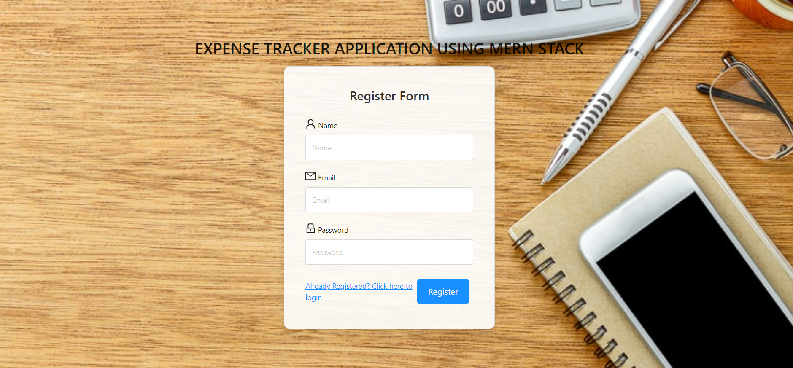

# Rohan Nashikkar — Portfolio Website

A responsive, recruiter-friendly portfolio built with plain HTML, CSS, and JavaScript. No build tools, packages, or paid hosting are required.

## Files

- `index.html` — complete website; styles and JavaScript are included
- `assets/Rohan-Nashikkar-Resume.pdf` — add your current resume PDF here
- `assets/projects/` — add up to four screenshots per project using the filenames below
- `assets/certificates/` — optional certificate images or PDFs

## Customize before publishing

1. Verify your LinkedIn and GitHub profile URLs and replace all generic project repository links with the exact repository URLs.
2. Add your resume PDF as `assets/Rohan-Nashikkar-Resume.pdf`.
3. Add project screenshots using the exact filenames below. The four-slide carousel for each project is already built into the website.
4. Replace all six certificate cards with the exact certificate/publication names, issuer/year, and valid credential links. Do not publish placeholder details.
5. Verify education scores and dates. The SIES score is shown as `9.25` without a label because you should confirm whether it means CGPA or percentile before publishing.
6. Confirm the exact venue and citation details of the IEEE paper before describing it as an IEEE publication.
7. Do not publish confidential employer details, source code, internal architecture, customer data, credentials, or proprietary screenshots.

## Project screenshot filenames

**Expense Tracker System**
- `assets/projects/expense-tracker-1.png`
- `assets/projects/expense-tracker-2.png`
- `assets/projects/expense-tracker-3.png`
- `assets/projects/expense-tracker-4.png`

**Gemini Clone**
- `assets/projects/gemini-clone-1.png` through `assets/projects/gemini-clone-4.png`

**Tour & Travel Hiking Website**
- `assets/projects/travel-website-1.png` through `assets/projects/travel-website-4.png`

**HARVESTIFY**
- `assets/projects/harvestify-1.png` through `assets/projects/harvestify-4.png`

Save screenshots at those paths. In `index.html`, replace the matching `.gallery-placeholder` block with an image, for example:

```html
<div class="gallery-slide">
  
</div>
```

Repeat for each slide you want to show. If you have fewer than four screenshots, you can remove extra slides and the carousel dots will adjust automatically.

## Run locally

Double-click `index.html` to open it in your browser. You can also open the folder in VS Code and use the Live Server extension.

## Publish free with GitHub Pages

1. Sign in to GitHub and create a **public repository** named `rohan-portfolio` (or another name you prefer).
2. Upload `index.html`, `README.md`, and the `assets` folder, keeping `index.html` at the repository root.
3. Open **Settings → Pages**.
4. Under Build and deployment, choose **Deploy from a branch**.
5. Select branch `main` and folder `/(root)`, then click **Save**.
6. GitHub Pages will display the published URL in Settings → Pages. It will look like `https://YOUR-USERNAME.github.io/rohan-portfolio/`.

## Certificates and links

Prefer the issuer's official credential verification link. If using Google Drive, share only the individual certificate file and set access to **Anyone with the link — Viewer**. Test the link in a private/incognito window. Replace all placeholder certificate links before sharing the portfolio.

## Privacy and security

- The contact form opens the visitor's email app; it does not collect or store submissions.
- Do not add passwords, API keys, tokens, internal employer screenshots, or confidential code to a public repository.
- Your phone number and email are public on this site. Remove the phone contact card if you do not want it public.
